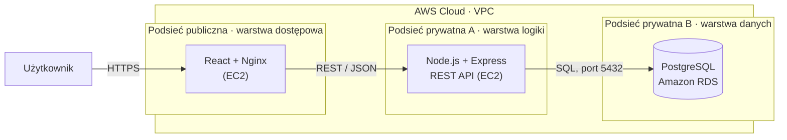

# taskflow-aws

> System webowy do zarządzania zadaniami, wdrażany w chmurze publicznej **AWS** w izolowanej architekturze trójwarstwowej (3-tier).

Projekt semestralny realizowany w ramach przedmiotu **Projekt zespołowy: Aplikacja w wybranej chmurze publicznej** Aplikacja jest rozwijana iteracyjnie, a każdy blok zajęć dodaje kolejny element, więc ten plik jest aktualizowany na bieżąco.

## Spis treści

1. [Opis projektu](#opis-projektu)
2. [Zespół](#zespół)
3. [Funkcjonalności](#funkcjonalności)
4. [Architektura](#architektura)
5. [Stos technologiczny](#stos-technologiczny)
6. [Wzorce projektowe](#wzorce-projektowe)
7. [Struktura repozytorium](#struktura-repozytorium)
8. [Uruchomienie lokalne](#uruchomienie-lokalne)
9. [Wdrożenie w chmurze](#wdrożenie-w-chmurze)
10. [Organizacja pracy](#organizacja-pracy)
11. [Harmonogram i status](#harmonogram-i-status)

## Opis projektu

**taskflow-aws** porządkuje pracę w jednym, zawsze aktualnym miejscu. Zalogowany użytkownik może tworzyć, przeglądać, edytować i usuwać swoje zadania oraz filtrować je według statusu i priorytetu. Dostęp do funkcji aplikacji wymaga rejestracji i logowania.

Aplikacja ma być wdrożona w chmurze AWS jako trzy osobne warstwy: publiczny frontend, backend REST API bez publicznego adresu IP oraz zarządzana baza danych dostępna wyłącznie z warstwy aplikacji.

## Zespół

Projekt realizowany jest samodzielnie, więc jedna osoba pełni funkcję Project Managera i wszystkie role.

| Rola | Osoba | Nr studenta |
|---|---|---|
| PM/DevOps | Krystian Górny | 95668 |
| Frontend | Krystian Górny | 95668 |
| Backend | Krystian Górny | 95668 |
| DBA | Krystian Górny | 95668 |

## Funkcjonalności

Zakres jest planowany. Pozycje zostaną odhaczone w miarę postępu prac.

**Zakres minimalny:**

- [ ] rejestracja i logowanie użytkownika
- [ ] widok listy zadań
- [ ] widok szczegółowy pojedynczego zadania
- [ ] operacje CRUD (tworzenie, edycja, usuwanie)
- [ ] walidacja danych po stronie klienta i serwera
- [ ] komunikacja frontend-backend przez REST API

**Zakres rozszerzony (planowany):**

- [ ] role użytkowników (admin / user)
- [ ] wyszukiwanie, filtrowanie i paginacja
- [ ] historia zmian i statusy zadań
- [ ] obsługa błędów i komunikaty dla użytkownika
- [ ] integracja z usługą chmurową (Amazon S3)

## Architektura

Szkic koncepcyjny architektury trójwarstwowej w chmurze AWS:



| Warstwa | Umiejscowienie | Zasada dostępu |
|---|---|---|
| Dostępowa (Web / Frontend) | podsieć publiczna | dostępna z Internetu |
| Logiki (Backend API) | podsieć prywatna A | bez publicznego IP, ruch tylko z warstwy Web |
| Danych (Database) | podsieć prywatna B | ruch tylko z warstwy aplikacji |

Izolacja warstw zostanie zrealizowana przez podsieci w jednym VPC oraz reguły Security Groups. Szczegółowy schemat sieci powstanie w Bloku 3, a finalny diagram architektury w Bloku 13.

## Stos technologiczny

| Obszar | Technologia |
|---|---|
| Chmura | AWS (VPC, EC2, RDS, Security Groups, IAM) |
| Front-end | React (Vite) |
| Back-end | Node.js + Express.js (REST API) |
| Baza danych | PostgreSQL (Amazon RDS) |
| Uwierzytelnianie | JWT + bcrypt |
| Infrastruktura jako kod | Terraform |
| CI/CD | GitHub Actions |
| Środowisko lokalne | Docker Compose |
| Kontrola wersji i organizacja pracy | Git, GitHub, GitHub Projects |

## Wzorce projektowe

- **MVC (Model-View-Controller):** podział aplikacji na model, widok i kontroler.
- **Repository Pattern:** warstwa pośrednicząca między logiką biznesową a źródłem danych.
- **DTO (Data Transfer Object):** proste obiekty do przesyłania danych między frontendem a backendem.

## Struktura repozytorium

Planowany układ katalogów (na tę chwilę istnieje `docs/`, pozostałe powstaną w kolejnych blokach):

```text
taskflow-aws/
├── frontend/   # aplikacja React
├── backend/    # API Node.js + Express
├── infra/      # Terraform i konfiguracja infrastruktury AWS
├── docs/       # dokumentacja, deklaracja projektu, diagramy
└── README.md
```

Konfiguracja aplikacji odbywa się przez zmienne środowiskowe. W repozytorium znajdzie się tylko plik `.env.example`, a prawdziwe dane (hasła, klucze, tokeny) nigdy nie trafią do kontroli wersji.

## Uruchomienie lokalne

*Sekcja w przygotowaniu. Zostanie uzupełniona po Blokach 5-6, gdy powstaną backend, baza danych i frontend.*

Planowane wymagania: Git, Node.js (wersja LTS), Docker oraz Docker Compose.

## Wdrożenie w chmurze

*Sekcja w przygotowaniu. Zostanie uzupełniona po Blokach 3-4 (sieć i serwery) oraz 8 (automatyczny deployment).*

Zakres: sieć VPC z podsieciami, serwer Web (EC2), serwer API (EC2), baza PostgreSQL (RDS), reguły Security Groups oraz automatyzacja wdrożeń przez GitHub Actions.

## Organizacja pracy

- **Zadania:** tablica Kanban w GitHub Projects (kolumny: Todo → In Progress → In Review / PR → Done), a zadania prowadzone jako issues z przypisanym wykonawcą.
- **Gałęzie:** praca na osobnych gałęziach (`feature/...`, `docs/...`), bez commitów bezpośrednio do `main`.
- **Zmiany:** każda zmiana trafia do `main` przez Pull Request, a commity są małe i mają czytelne opisy.

## Harmonogram i status

| Blok | Zakres | Status |
|---|---|---|
| 1 | Start, deklaracja projektu, repozytorium, tablica zadań, szkic architektury | gotowy |
| 2 | Tablica zadań, schemat 3-tier, konfiguracje lokalne, foldery w repo | zaplanowany |
| 3 | Konto AWS, sieć VPC i podsieci | zaplanowany |
| 4 | Szkielet aplikacji: serwer aplikacji (prywatna) i warstwa Web (publiczna) | zaplanowany |
| 5 | Backend, REST API i baza danych | zaplanowany |
| 6 | Funkcje biznesowe UI i integracja end-to-end | zaplanowany |
| 7 | GitHub Actions, CI i skanowanie bezpieczeństwa | zaplanowany |
| 8 | Automatyzacja deploymentu do chmury (CD) | zaplanowany |
| 9 | Bezpieczeństwo i hardening chmury | zaplanowany |
| 10 | Optymalizacja kosztowa (FinOps) i monitoring | zaplanowany |
| 11 | Testy integracyjne i automatyczne testy E2E | zaplanowany |
| 12 | Code freeze, stabilization i bug fixing | zaplanowany |
| 13 | Dokumentacja, diagram architektury, README | zaplanowany |
| 14 | Próba generalna, audyt przedfinałowy | zaplanowany |
| 15 | Prezentacja i live demo | zaplanowany |
